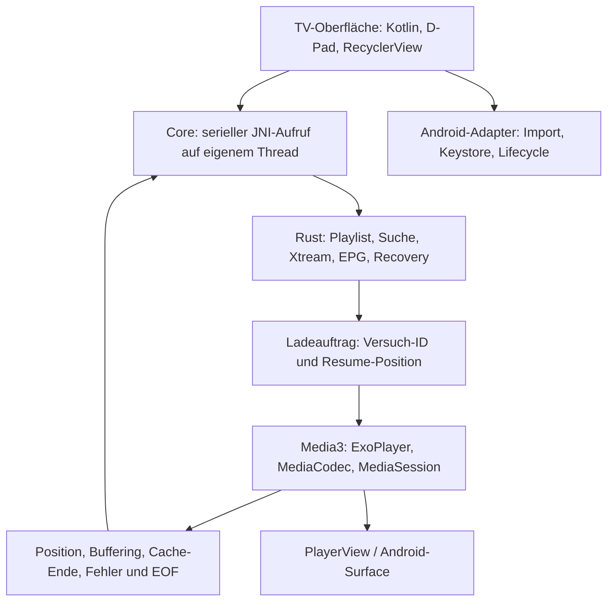

# Plattformanalyse und Architektur

## Benutzerbibliothek 0.4.2

„Zuletzt gesehen“, Favoriten und Fortsetzen für Live, Movies und Series. Katalog-Schema 3 speichert pro Eintrag einen gesalzenen, über Neuimporte stabilen Inhaltsschlüssel (`ukey`, indiziert). Serien verwenden ihre Show-Identität. `resolve` bildet gespeicherte Schlüssel begrenzt auf die aktuelle Revision ab, und `select` nimmt eine Fortsetzungsposition an. Benutzerdaten liegen getrennt von den Kataloggenerationen in `user-library.enc` (Keystore, AtomicFile) und werden von einem einzigen IO-Writer gebündelt geschrieben. Player-Ereignisse kommen aus dem bestehenden Sekundenticker und sind an die jeweilige Auswahl gebunden. Details: [Benutzerbibliothek 0.4.2](USER_LIBRARY_042.md).

## Inhaltsbibliothek 0.4.0

Schema 2 ergänzt persistente Serienidentitäten und Episodenmitgliedschaften, Originalmetadaten sowie Jahr/Qualität. `browse` dedupliziert Serien vor dem Paging; `series_page` liefert begrenzte Staffel-/Episodenseiten. M3U-Titelgruppierung und Xtream-Anbieteridentitäten bleiben unterscheidbar. `search` bleibt die rohe Eintragsabfrage. Schema 1 ist im Offline-Übergang lesbar; die vollständige Neuklassifikation benötigt einen erneuten Quellenimport ohne alte HTTP-Validatoren. Der gemeinsame Media3-Player bleibt unabhängig vom Browserzustand; Channel-Tasten navigieren im tatsächlichen Wiedergabekontext. Architektur, Budgets und Upgrade: [Filme und Serien 0.4.0](CONTENT_LIBRARY_040.md).

## Aktueller Katalogpfad seit 0.3.0

Der nachfolgend dokumentierte ursprüngliche Voll-RAM-Import wurde für den Android-Produktpfad ersetzt. `SourceLoader` verarbeitet Datei/HTTP/Xtream auf I/O-Threads und erstellt über einen kurzlebigen separaten JNI-Core einen neuen SQLite-Katalog. `parse_stream` bzw. der inkrementelle Xtream-Array-Reader schreiben einzelne Einträge transaktional; URL, Logo und Streamheader liegen als AES-256-GCM-Records vor. Zufällige Katalogschlüssel und das Quellenmanifest sind über den Android Keystore versiegelt. Kategorien und Suchtext bleiben zur Abfrage im privaten, vom Backup ausgeschlossenen Katalog.

Ein erfolgreicher Import öffnet erst den fertig validierten Katalog in der aktiven Engine. Der alte Katalog bleibt bis dahin nutzbar; Hintergrundaktualisierungen bauen eine neue Generation ohne Änderung der laufenden Wiedergaberevision. JNI-Abbruchsignal und OkHttp-Call-Abbruch begrenzen stornierte Arbeiten. SQLite-Caches liegen bei 2 MiB je Verbindung, große Sortierungen verwenden temporären Dateispeicher. Das UI hält maximal 512 DTOs und lädt Seiten in beide Richtungen. Suchabfragen bewahren die bisherige Unicode-/Teilstring-/Mehrbegriffssemantik.

Der letzte aktive Quellenkatalog wird offline wiederhergestellt. HTTP-Validatoren ermöglichen 304; geänderte verfügbare Dateimetadaten oder ein 15 Minuten alter Stand lösen eine Hintergrundaktualisierung aus. Der aktuelle und der vorherige vollständige Katalog bleiben geschützt; Bereinigung entfernt ausschließlich bekannte abgelöste Generationen, keine fremden Staging-Dateien. Importgrenzen: 512 MiB, 2.000.000 Einträge, 20.000 Kategorien; Xtream-Einzelobjekte 1 MiB, Kategorienantworten und Seriendetails je 8 MiB. EPG behält die bisherigen Grenzen. Der ältere In-Memory-Service bleibt für vorhandene Core-Tests und Kompatibilität bestehen, ist aber nicht der App-Importpfad.

Xtream-Serien werden als Serienobjekte importiert. Beim Öffnen werden Staffeln/Episoden aufgelöst und im Katalog unter ihrer Serie gespeichert; sie verändern die Anzahl der Katalogobjekte nicht. M3U-Episoden bleiben direkt abspielbare Einträge. Der SQLite-Katalog ist aktuell Android-Core-Infrastruktur; das Windows-Projekt wurde nicht umgebaut. Messungen und verbleibende Geräteabnahme: [Umsetzungsbericht 0.3.0](PLAYLIST_IMPLEMENTIERUNG_030.md).

## Bestehender Windows-Player

| Modul | Android-Entscheidung |
| --- | --- |
| `playlist`, `recovery`, `buffering`, `telemetry` | Unveränderte Core-Übernahme mit zusätzlichen Service-Grenzen |
| `sources` | Reines Xtream-Mapping in Rust; Transport/Dateizugriff im Android-Adapter |
| `http` / WinHTTP | OkHttp für Quellenimport; Media3-Datenquellen für Wiedergabe, Android-Vertrauensspeicher |
| `secrets` / DPAPI | Android Keystore AES-GCM und AtomicFile |
| `library` | Revisionsgebundene aktive Bibliothek in Rust; gespeicherte Quellen in Kotlin. Unterschied zur Windows-App: Quellenwechsel stoppt Wiedergabe. |
| `app`, `add_playlist`, `main` | Native Kotlin-TV-Ansichten, RecyclerView und Android-Dokumentauswahl |
| `video_window` / HWND | Media3 PlayerView / SurfaceView und Activity-Lifecycle |
| `mpv`, `player` | ExoPlayer, MediaCodec, MediaSession; Session-Recovery weiterhin in Rust |
| `quality` / D3D11 / RTX | Android-Decoder-/Displayfähigkeiten; kein RTX auf TV |
| `diagnostics`, `log_analysis` | Bestehende JSONL-Implementierung nicht eingebunden; App liefert redigierte Zustandsmeldungen. Persistente Diagnose bleibt eine Erweiterung. |
| Ressourcen-Build, DLL-Paketierung | Gradle, NDK, JNI-`.so`, APK/AAB und ABI-Filters |

## Layer

Native Views wurden für diesen ersten Build gewählt: fokusfähige Android-Widgets und virtualisierte Listen sind unmittelbar mit PlayerView kombinierbar; zusätzliche Compose-/Rust-Rendering-Layer entfallen. Spätere Compose-TV-Ansichten können dasselbe Core-/Playback-API verwenden. JNI überträgt ausschließlich JSON-Kommandos und begrenzte DTO-Seiten, keine Video-/Audioframes. Eigene Handle-Registry statt ungeprüfter Zeiger. Destroy entfernt den Handle; laufende Calls halten einen `Arc`. Panics/ungültiges JSON werden an der Fassade zu Fehlercodes.

## Session-Vertrag

1. Erfolgreicher Import ersetzt Playlist, Suchcache und Revision zusammen. Fehler lassen die vorherige Playlist intakt.
2. Kategorien/Seiten liefern keine Stream-URLs. Nur `select`/`reconnect` geben die Quelle an den Media-Adapter. Eine Kanal-ID gilt ausschließlich in ihrer Playlist-Revision.
3. Jeder neue Load erhält eine monoton wachsende Versuch-ID, auch ein Retry desselben Kanals. Rust und Kotlin verwerfen veraltete Rückmeldungen. Ein Mutex serialisiert UI-Befehle, Lifecycle, Tick und Media-Callbacks.
4. Media3 führt keine eigenen vollständigen Lade-Retries aus. Rust entscheidet nach Startup/Stall/Refill/EOF/Backendfehler über Backoff und Reload. Laufende Requests werden im Waiting-Zustand gestoppt. Permanente HTTP-/Formatfehler verlangen manuelle Korrektur.
5. Position/Buffer/Cache-Ende und tatsächlich gezählte Netzwerkbytes werden bei aktiver Wiedergabe einmal pro Sekunde abgefragt. Ein atomarer `poll`-Aufruf übernimmt Pausenzustand, Telemetrie und Watchdog; veraltete Versuch-IDs dürfen keinen dieser Zustände verändern. Unbekannter Durchsatz bleibt `null`. Identische Pausenmeldungen setzen den Watchdog nicht fortlaufend zurück. Kein JNI-Polling ohne ausgewählten Kanal. Ein eigener, versuchsgebundener Coroutine-Timer setzt die Rust-Retry-Deadline um; der Sekundentakt bleibt als Fallback erhalten.
6. Home/Standby pausiert den Core und gibt Player, Session und Surface frei. Vordergrund erzeugt einen frischen Versuch. Live startet am aktuellen Rand, VOD an der letzten Sample-Position. Keine Hintergrundwiedergabe und kein Foreground-Service.

## Speicher, Threads und Transport

Seit 0.2.1 erhält Live separate Media3-Pufferprofile mit 1/3/6 Sekunden Vorleseziel und 16/32/64 MiB Byte-Ziel. Standard: 3 Sekunden, Start ab 0,5 Sekunden, Fortsetzen nach Unterlauf ab 1 Sekunde. VOD behält das 10–30-Sekunden-Profil. Der Byte-Schwellwert wird vor der Zeit priorisiert; weder daraus noch aus den Zeitgrenzen folgt ein hartes Prozess-RAM-Limit oder eine exakte Live-Latenz. Profilwechsel wirken beim nächsten Load. Media3 übernimmt weiterhin native ABR, die mpv-Refill-Steuerung bleibt inaktiv.

128 MiB je Import, maximal 500.000 Kanäle, maximal 250.000 XMLTV-Einträge; einzelne XMLTV-Texte maximal 16 KiB. Die vorherigen Grenzen von 32 MiB/100.000 Einträgen blockierten die reale Testliste und wurden in 0.1.1 mit Regressionstests angepasst. Begrenzte Seiten von höchstens 128 DTOs, UI-Seite 64. Die Suchtreffer werden pro Filter gecacht. Der Core besitzt genau eine aktive Playlist und einen EPG-Index. Xtream-JSON benötigt beim Import zusätzliche kurzfristige Kopien; bei extrem großen Anbietern wäre SAX/Streaming-Mapping die nächste Optimierung.

Netzwerk/Datei-I/O läuft auf `Dispatchers.IO`, Rust auf einem dedizierten Executor; ExoPlayer und Surface bleiben auf dem Main-Looper. Android-Lifecycle und UI-Kommandos werden vor Ausführung serialisiert. Activity-Schließen bricht offene Import-HTTP-Calls ab. Ein Import blockiert andere Rust-Operationen für seine begrenzte Dauer; ein separater Import-Handle wäre bei messbaren langen Importzeiten der nächste Schritt.

HTTP ist für ältere IPTV-Anbieter absichtlich erlaubt. TLS-Zertifikate werden regulär geprüft, automatische HTTPS→HTTP-Weiterleitungen sind gesperrt. Dateizugriff über SAF, keine allgemeinen Speicherberechtigungen. Importdateien werden in `finally` gelöscht; Zugangsdaten werden atomar verschlüsselt und von Backups ausgeschlossen.

## Nachgeschlagene Android-Grundlagen

- [Media3 1.11.1 und Module](https://developer.android.com/jetpack/androidx/releases/media3)
- [TV-App-Manifest und Eingabe](https://developer.android.com/training/tv/get-started/create)
- [TV-Qualitätsanforderungen](https://developer.android.com/docs/quality-guidelines/tv-app-quality)
- [16-KB-Seitengrößen](https://developer.android.com/guide/practices/page-sizes)
- [Ziel-API-Vorgaben](https://developer.android.com/google/play/requirements/target-sdk)
- [AGP 8.13](https://developer.android.com/build/releases/agp-8-13-0-release-notes)

Stand der Recherche: 15. Oktober 2026. TV-Manifest, Launcher-Banner, D-Pad, beide ARM-Architekturen, Target 36 und 16-KB-Linker-/APK-Ausrichtung werden technisch vorbereitet/geprüft. Store-Freigabe, Datenschutzerklärung, Inhaltsrechte und signiertes Publisher-Paket sind davon unabhängige Release-Schritte.

